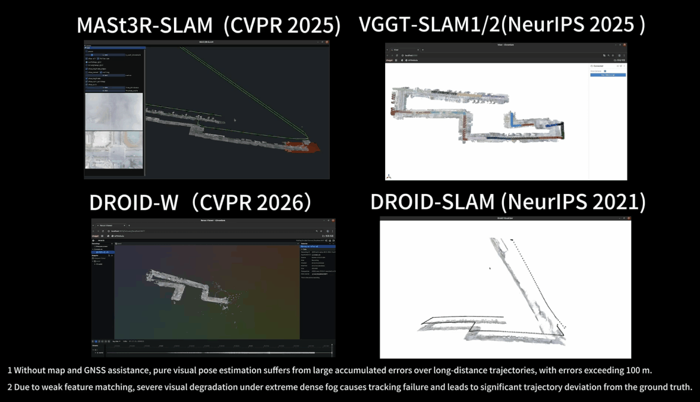
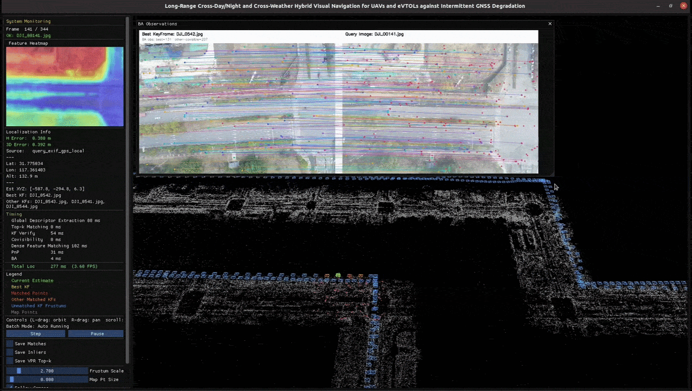
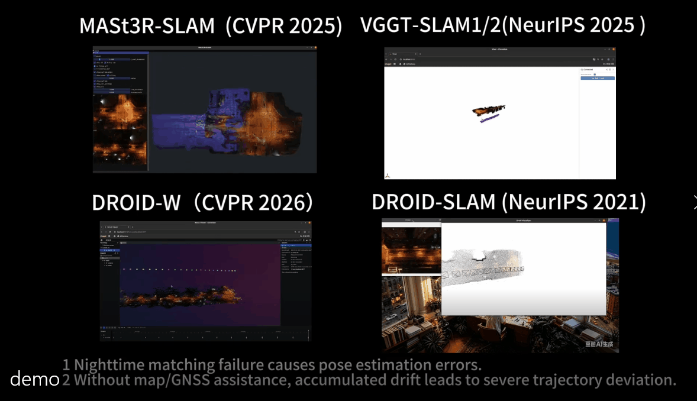
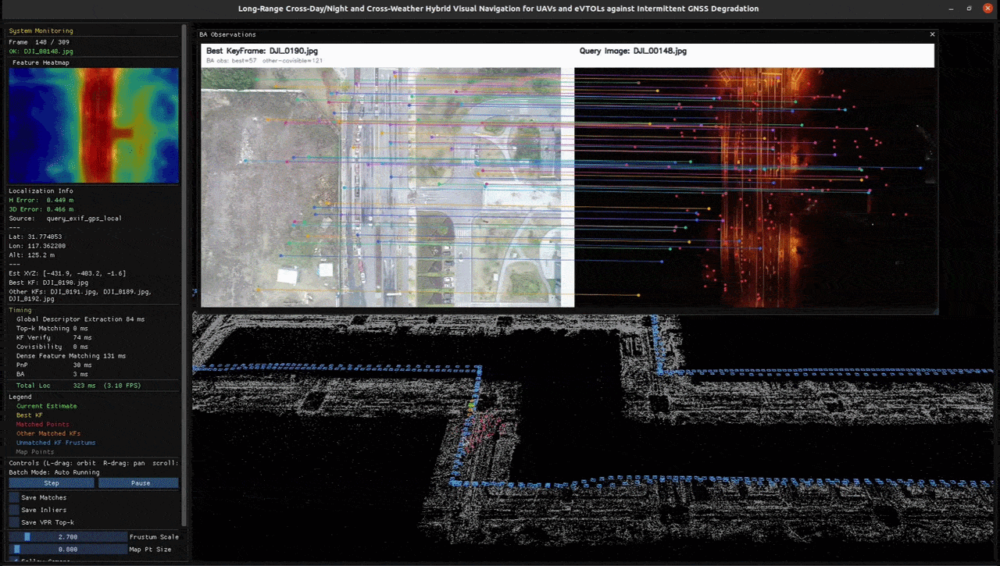

<p align="center">
  <h1 align="center">LD-AtlasLoc: Long-Distance Monocular Aerial Image Localization with Geo-Referenced Sparse Maps under GNSS-Degraded and Appearance-Changing Conditions</h1>
  <p align="center">
    <strong>Li Dongdong</strong> |
    <strong>Yang Tao</strong> |
    <strong>Qin Shuo</strong> |
    <strong>Zhang Yisu</strong> |
    <strong>Li Jing</strong>
  </p>
  <h3 align="center">
    <a href="https://robot-vision.net/">Paper</a> |
    <a href="https://www.youtube.com/watch?v=1-a3fRpCcGE">YouTube Demo</a> |
    <a href="https://v.qq.com/x/page/s32753laghj.html">Tencent Demo</a> 
  </h3>
</p>

<h2 align="center">Qualitative Comparisons</h2>

<h3 align="center">Foggy Scene - Baseline Method</h3>

<p align="center">
  
</p>

<h3 align="center">Foggy Scene - LD-AtlasLoc (Ours)</h3>

<p align="center">
  
</p>

<h3 align="center">Night Scene - Baseline Method</h3>

<p align="center">
  
</p>

<h3 align="center">Night Scene - LD-AtlasLoc (Ours)</h3>

<p align="center">
  
</p>

<br>

## Overview

Accurate, long-distance UAV and eVTOL navigation remains a critical challenge in urban canyons, complex electromagnetic environments, and under GNSS interference. While visual SLAM reduces GNSS reliance, it often suffers from drift and tracking failure under drastic appearance changes (fog, rain, day-night).

**LD-AtlasLoc** is a monocular visual relocalization framework designed for **intermittent GNSS-degraded scenarios**. It bridges the gap between high-precision mapping and robust online localization.


## DEMO
https://github.com/Ldd-slam/LD-AtlasLoc/blob/main/demo.mp4


## Dataset Description


<video controls width="720">
  <source src="https://github.com/Ldd-slam/LD-AtlasLoc/releases/download/v1.0/demo.mp4" type="video/mp4">
</video>


LD-AtlasLoc is constructed to reflect **real-world low-altitude flight constraints**, covering diverse urban and suburban environments. Unlike conventional datasets, it focuses on flight-compliant trajectories and challenging environmental conditions.

### 🚁 Flight Profile & Compliance
- **Realistic Altitude:** Flights are conducted at **120–150 m**, aligning with typical low-altitude logistics and urban eVTOL operational limits.
- **Compliant Trajectories:** Paths strictly follow **urban roads, green belts, and open areas**, avoiding arbitrary intrusion into dense built-up zones.
- **Safety Constraints:** Collection adheres to real-world regulations, including airspace permissions, safe distances from buildings, and privacy standards.

### 🌦️ Environmental Diversity
The dataset introduces substantial variations to challenge visual robustness:

| Dimension | Conditions Covered |
| :--- | :--- |
| **Season** | Winter ↔️ Spring (significant vegetation changes) |
| **Illumination** | High solar elevation, long building shadows, night vs. day |
| **Weather** | ☀️ Sunny · ☁️ Cloudy · 🌫️ Foggy · 🌧️ Rainy · 🌃 Night |

**Specific Challenges:**
- **Fog:** Severe visibility degradation, with near-total texture loss in most regions.
- **Rain:** Local blur, reflections, and sensor noise.
- **Low-light / Night:** Underexposure, streetlight glare, motion blur, and reduced descriptor discriminability.

### 🏙️ Scene Composition
We cover three representative low-altitude urban environments:

| Scene ID | Description | Key Characteristics |
| :--- | :--- | :--- |
| **City1-Buildings** | Mixed Urban-Suburban | Combination of high-rise and low-rise structures. |
| **City2-Skyscrapers** | Dense Urban Center | **24–30 stories** (up to 120 m). Exhibits severe **Urban Canyon
| **City3-outskirts** | ​Suburban / Rural Fringe | **Sparse vegetation** and **repetitive ground textures** leading to feature scarcity. |


### 1. Data Description​
The compressed files City1-buildings.rar, City2-skyscrapers.rar, and City3-outskirts.rar contain image data. The original resolution of 5472×3648 has been downscaled to 1805×1203.
### 2. RTK-GNSS Information​
Each image retains RTK-GNSS information with centimeter-level accuracy, which can be used for mapping and ground-truth error evaluation.
### 3. Data Collection Details​
Multiple sequences per scene were recorded along the same trajectory across different times. Trajectories are not strictly repeated, with ~20 m deviations in all directions to simulate realistic flight perturbations, thereby enabling robust evaluation of localization across diverse parallax views.

## Dataset Access

- [Baidu Netdisk](https://pan.baidu.com/s/1QL3i6Cz4F0489Y-cX65Z4Q?pwd=3spe/)


## Contact
- [Personal Email](https://robot-vision.net/)
- [Personal Email](1051196347@qq.com)


```bibtex
@electronic{LDATLASLOC2024,
  author       = {D. Li and T. Yang and S. Qin and Y. Zhang and J. Li},
  title        = {{LD-AtlasLoc}: Long-Distance Monocular Aerial Image Localization with Geo-Referenced Sparse Maps under GNSS-Degraded and Appearance-Changing Conditions},
  year         = {2026},
  howpublished = {Online}. Available: \url{https://github.com/Ldd-slam/LD-AtlasLoc},
}
```d
